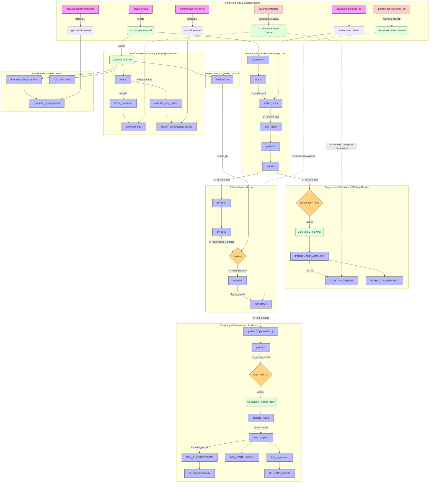
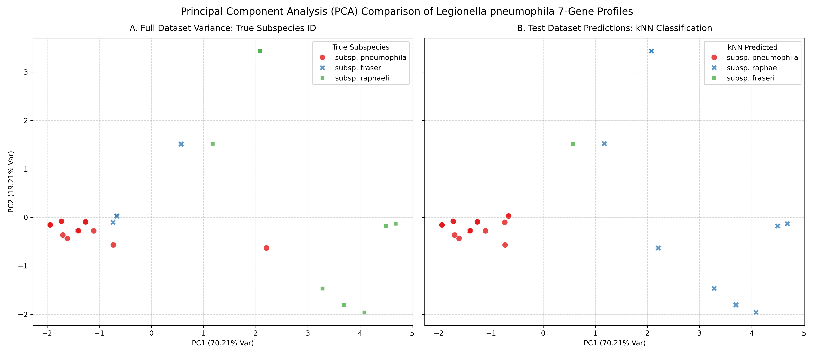
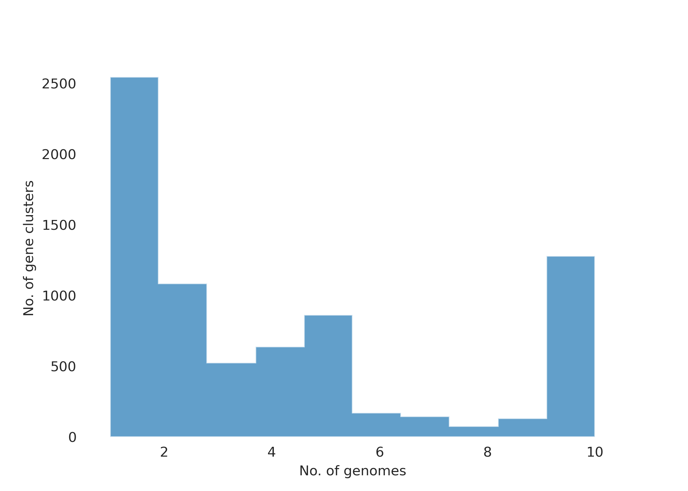
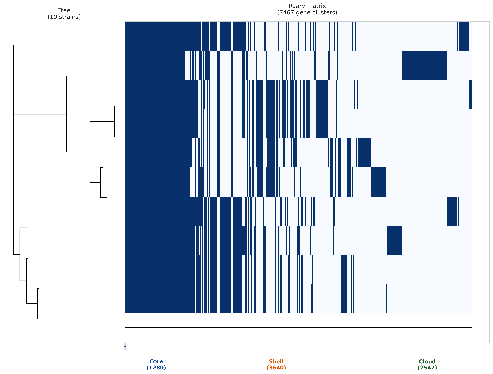
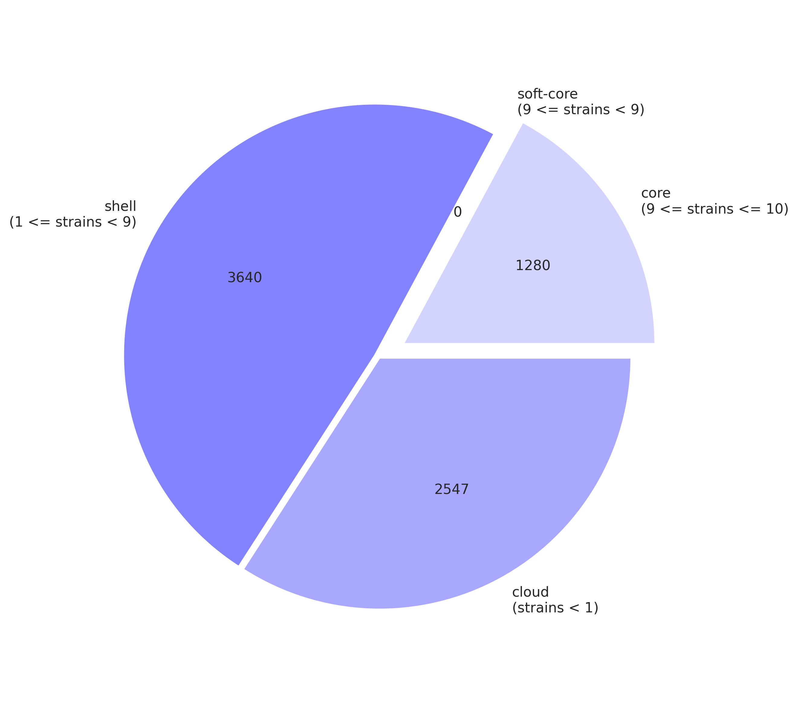
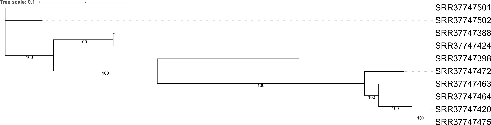

# Pipeline
<table>
  <tr>
    <td valign="top" width="15%">
      
    </td>
    <td valign="top">
      <h2>Pipeline is a scalable, automated <strong>Nextflow DSL2 pipeline</strong> for genomic characterization, quality control, phylogenetic mapping, and machine learning-driven subtyping of <em>Legionella pneumophila</em> assemblies.</h2>
    </td>
  </tr>
</table>


## 📖 What Pipeline Does

This pipeline provides a unified "sequence-to-insight" workflow for raw bacterial FASTA assemblies. It processes strains simultaneously through a hybrid architecture of linear analytical steps and asynchronous multi-sample cohort steps:

* **In Silico Serotyping & Subtyping:** Leverages `ELGATO` and `Legsta` for automated sequence typing (MLST).
* **Taxonomic Assignment:** Uses `Kraken2` for deep subspecies-level identification.
* **Genomic Surveillance & Typing:**
  * **cgMLST Profiling:** Runs `chewBBACA` to call alleles and generate comprehensive core genome MLST matrices for high-resolution cluster tracking.
  * **Plasmid Epidemiology:** Utilizes `MOB-Suite` (`mob_typer`) to reconstruct and type plasmid markers across assemblies.
* **Assembly Quality Control:** Runs asynchronous `CheckM` evaluations to assess completeness and contamination.
* **Core & Pan-Genomic Phylogeny:** 
  * Identifies reference-free core SNPs using `kSNP4`, calculates symmetrical pairwise **SNP distance matrices**, and clusters isolates into high-precision **transmission chains**.
  * Builds bootstrapped maximum-likelihood trees using `IQ-TREE` and generates publication-ready, metadata-integrated **annotated phylogenetic tree charts**.
  * Generates structural annotations (`Prokka`) and executes gene-family clustering (`Roary`) to extract cloud maps and visualize the pangenome structure.
* **Comparative Genomics:** Calculates reciprocal whole-genome Average Nucleotide Identity (`FastANI`) against reference libraries.
* **Predictive Analytics & Advanced Modeling:** 
  * Imputes missing loci elements (`miceforest`) and trains a **K-Nearest Neighbors (KNN)** classifier to resolve *L. pneumophila* subspecies, complete with cross-validation **confusion matrix metrics**.
  * Conducts **Principal Component Analysis (PCA)** post-classification to visualize high-dimensional feature distributions and variance.
  * Subjects downstream profiles to data-driven **Firth Logistic Regression** alongside a terminal **Lasso Multinomial Logistic Regression** model for feature pruning and classification.
  
  > 💡 **Why this matters:** By integrating predictive modeling directly into the pipeline, users can transition from purely descriptive genomics to active discovery—leveraging machine learning to automatically resolve complex subspecies classifications, control for statistical separation in highly similar cohorts, and isolate the exact genetic features driving outbreak profiles.

---

## 📊 Pipeline Workflow Diagram
This chart outlines how independent single-sample data streams run alongside asynchronous, multi-sample cohort configurations:



---

## 🛠 Dependencies

The pipeline relies on a containerized or environment-managed runtime strategy to maximize reproducibility. You do not need to install the individual bioinformatics utilities manually.

### Core Frameworks
* **Nextflow** (Runtime tool; Java-based engine)

### Container Registries (Docker / Singularity)
The pipeline automatically fetches and launches isolated tool tasks using the following community layers:
* `staphb/prokka:1.15.6` - Structural genome annotations
* `staphb/roary:3.13.0` - High-performance pangenome calculation & graphing scripts
* `staphb/ksnp4:4.1-2607` - Core k-mer SNP phylogenetics and file layout parsing
* `staphb/kraken2:2.17.1` - High-speed database string matching
* `quay.io/biocontainers/chewbbaca:3.3.3--pyhdfd78af_0` - Core Genome MLST (cgMLST) allele calling and profiling matrix extraction
* `docker://quay.io/biocontainers/mob_suite:3.1.9--pyhdfd78af_0` - Plasmid typing, reconstruction, and biomarkers typing via MOB-typer
* `staphb/fastani:1.34` - Fast, alignment-free computation of whole-genome Average Nucleotide Identity
* `staphb/iqtree2:2.4.0` - Efficient and robust maximum-likelihood phylogenomic tree building with bootstrapping

### Conda Profiles (Local Fallbacks)
Statistical, machine learning, and reporting scripts drop down to local environment recipes utilizing:
* `pandas` & `numpy` (Structured data parsing matrices and custom pairwise SNP distance computations)
* `scikit-learn` (KNN Classification engines, PCA dimensionality reduction, Lasso Multinomial Logistic Regression modeling, and cross-validation confusion matrix metrics)
* `miceforest` (Iterative Chained Equations imputation)
* `matplotlib` & `seaborn` (Statistical matrix plotters, scatter layouts, heatmaps, and classification confusion matrix visualizations)
* `biopython` (Phylogenetic tree topology parsing and programmatic metadata rendering layouts)

---

## 💻 Resources Required

Requirements scale dynamically depending on your cohort batch sizing. Minimum allocations for the **10-sample testing baseline** include:

| Component | Minimum Specification | Recommended Specification | Notes |
| :--- | :--- | :--- | :--- |
| **CPU Threads** | 4 Cores | 8–16 Cores | `Roary (MAFFT)` and `kSNP4` scale linearly with core counts |
| **RAM** | 16 GB | 32 GB+ | Large `Kraken2` databases require memory headroom |
| **Storage** | 20 GB free space | 100 GB+ SSD | Accounting for database structures and intermediate caches |
| **OS** | Linux / macOS | Linux (Ubuntu/CentOS) | Essential for native Docker/Singularity daemon linking |

---

## 🚀 How to Run Clearwater (Usage)?

### 1. Clone the repository and change to your cloned directory
```bash
git clone https://github.com/BPHL-Molecular/pipeline.git
cd pipeline
```

### 2. Configure Parameters
Set up your file paths and parameters inside a `params.yaml` file or declare them inline during runtime execution.

### 3. Automatically create the pipeline conda environment to upload all conda packages
#### a) Execute this command on your terminal
```bash
conda env create -f PIPELINEenvironment.yml
```
#### b) Activate the created environment
```bash
conda activate PIPELINE
```

### 4. Execute Clearwater (2 options)

#### 4.1. Option 1: Standard Execution Command & Configuration

Launch the master execution run by pointing to your local directory architecture:

```bash
nextflow run clearwater_wf.nf   --input "/path/to/your/samples_fasta_dir"   --krakenSub_db "/path/to/kraken_database_files"   --output "results_output"   --ref_genomes_dir "/path/to/reference_library"   --metadata "/path/to/epidemiological_metadata.csv"   --snp_threshold 3   --cgmlst_threshold 7   -profile apptainer
```

### ⚙️ Parameter Configuration Matrix

| Parameter Flag | Type / Requirement | Default Value | Downstream Behavior Impact |
| :--- | :--- | :--- | :--- |
| **`--input`** | 🔴 **Required** | *None* | Roots the entry channel with assembly targets (`*.fasta`). |
| **`--krakenSub_db`** | 🔴 **Required** | *None* | Feeds database string matches directly into `kraken_subs`. |
| **`--output`** | 🔴 **Required** | *None* | Destination directory path for your structural tree layouts. |
| **`--ref_genomes_dir`** | 🟡 **Optional** | *None* | Omit to completely bypass the **runFastANI** analysis loop. |
| **`--metadata`** | 🟡 **Optional** | *None* | Omit to bypass plotting annotations on trees and pangenomes. |
| **`--snp_threshold`** | ⚙️ **Default** | **`3`** | Value threshold passed to `cluster_transmission_chains`. |
| **`--cgmlst_threshold`** | ⚙️ **Default** | **`7`** | Outbreak cluster verification cut-off for cgMLST logs. |

*To resume an interrupted or cached pipeline run without reprocessing completed steps, add the `-resume` flag.*

#### 4.2. Option 2: Run the provided sbatch script (SLURM Cluster Environments)
For high-performance computing clusters running the SLURM workload manager, inspect the provided script template, adjust your paths/parameters inside it, and submit the job:

```bash
sbatch pipeline_run.sh
```

### 📋 Metadata File Format (.csv)
When using the optional `--metadata` flag, provide a comma-separated values (`.csv`) file structured exactly as shown below.

<details>
<summary><b>Click to expand metadata format and column specifications</b></summary>

<br>

#### Sample Template Example:
```csv
SampleID,County,State/Territory,Year,Isolate_Sources
Isolate_01,Miami-Dade,FL,2026,Environmental
Isolate_02,Leon,FL,2025,Clinical
Isolate_03,Fulton,GA,2026,Clinical
```

#### Field Specifications:
*   **`SampleID` (First Column):** 🔴 **Required.** Entries *must exactly match* the filename prefixes of your input `*.fasta` assemblies (e.g., if your file is `Isolate_01.fasta`, the ID must be `Isolate_01`). This string forms the relational join key used to overlay metadata bands onto tree tips and pangenome heatmaps.
*   **`County`:** 🟡 **Optional.** Categorical metadata designating geographic county origin.
*   **`State/Territory`:** 🟡 **Optional.** Categorical metadata designating state or regional boundary origin.
*   **`Year`:** 🟡 **Optional.** Temporal metadata tracking isolation chronology.
*   **`Isolate_Sources`:** 🟡 **Optional.** Biological or environmental context category (e.g., Clinical, Coolingtower, Potable Water) utilized by `annotate_tree`, `PANGENOME_ANALYSIS`, and `PLOT_PANGENOME` for automatic group coloring.

</details>

---

## 📂 Example of Output

When execution finishes, the designated output directory (`params.output/`) will be populated with structured computational folders:

```text
results_output/
├── [SampleID]/                          # Individual sample analytics folders
│   ├── prokka_out/                      # GFF, FAA, FNA, and GBK file maps
│   ├── kraken_out/                      # Taxonomic classification and metagenomic profiling
│   ├── mash_out/                        # Genomic distance estimations and MinHash sketches
│   ├── elgato_out/                      # Targeted MLST or specific genotyping outputs
│   └── mob_suite_out/                   # Plasmid typing and reconstruction metrics per sample
├── checkm_qc/                           # Quality control and genome completeness assessments
├── fastani_out/                         # Pairwise Average Nucleotide Identity matrices
│   ├── fastani_matrix.txt               # Symmetrical identity comparison matrix
│   └── fastani_log.txt                  # Complete run log and parsing metadata
├── cgmlst_surveillance/                 # Core Genome MLST cluster surveillance
│   ├── chewbbaca_alleles/               # Called allele profiles and schema information
│   ├── cgmlst_matrix.tsv                # Comprehensive sample-by-allele profile matrix
│   └── cgmlst_outbreak_report.txt       # Cluster identification based on cgmlst_threshold
├── pangenome_analysis/
│   ├── cloud_genes_sample_map.txt       # Mapping of cloud genes across specific samples
│   ├── core_genes_list.txt              # Definitive list of identified core genome features
│   └── roary_out/
│       ├── gene_presence_absence.csv    # Global pangenome matrix spreadsheet
│       ├── summary_statistics.txt       # Breakdown of Core, Shell, and Cloud distributions
│       └── core_gene_alignment.aln      # MAFFT core gene sequence alignment file
├── pangenome_plots/                     # Visualizations of the pangenome structure
│   ├── pangenome_frequency.png          # Gene frequency distribution plot
│   ├── pangenome_matrix.png             # Presence/absence matrix heatmap
│   └── pangenome_pie.png                # Core vs. Cloud distribution pie chart (Metadata-annotated)
├── pca_plots/                           # Dimensionality reduction outputs
│   └── subspecies_pca_comparison_panel  # Comparative PCA scatter layout across cohorts
├── knn_classification_results/          # Supervised machine learning performance data
│   ├── knn_performance_metrics.txt      # Model precision, recall, and accuracy scores
│   ├── knn_predicted_subspecies         # Assigned taxonomic classifications per sample
│   └── cross_validation/                # Cross-validation performance evaluations
│       └── confusion_matrix.png         # Classification evaluation matrix plot
├── lassoMregression_results/
│   ├── lasso_model_summary.txt          # Model feature selection stats
│   ├── lasso_coefficients_reportingTable.csv # Feature performance scores
│   └── lasso_coefficients_heatmap.png   # Multiclass predictive heatmap
├── leg_sum_report.txt                   # Summary report file for the pipeline execution
├── firth_multinomial_formatted.txt      # Pre-formatted regression input data array
├── firth_multinomial_results.txt        # Firth-corrected logistic regression p-values and log-odds
├── ksnp_out/                            # Core k-mer SNP phylogenetics and validation files
│   ├── snp_distance_matrix.tsv          # Symmetrical pairwise SNP distance matrix
│   └── transmission_clusters.txt        # Transmission chains grouped by snp_threshold
└── bootstrap_tree/                      # IQ-TREE consensus tree and support value mappings
    ├── core_bootstrap.iqtree            # Detailed IQ-TREE execution log, models, and text-based tree
    ├── core_bootstrap.treefile          # Maximum-likelihood consensus tree file (Newick format)
    └── annotated_tree.png               # Metadata-integrated high-resolution tree visualization
```

### 📊 Generated Visualizations & Performance

<details>
<summary><b>🔍 Click to view PCA Dimensionality Reduction Panel (pca_plots/)</b></summary>
<br>

To view the separation performance across *Legionella pneumophila* 7-gene multi-locus profiles, open this comparison panel:

<div align="center">
  
  <p><i>Figure: Dimensionality reduction comparing full cohort ground truth (Left) against unseen kNN validation models (Right).</i></p>
</div>
</details>

<details>
<summary><b>📊 Click to view KNN Performance Metrics (knn_performance_metrics.txt)</b></summary>
<br>

Below is the evaluation summary and classification matrix generated by the machine learning module:

```text
======================================================================
         kNN SUBSPECIES CLASSIFIER PERFORMANCE SUMMARY                
======================================================================

Partitioning Strategy : 70% Training / 30% Testing
Overall Accuracy      : 66.67%

--- DETAILED EVALUATION METRICS (TEST SET) ---
                    precision    recall  f1-score   support

    subsp. fraseri       0.00      0.00      0.00         1
subsp. pneumophila       0.67      1.00      0.80         2

          accuracy                           0.67         3
         macro avg       0.33      0.50      0.40         3
      weighted avg       0.44      0.67      0.53         3

--- ALIGNED CONFUSION MATRIX ---
True / Pred        | subsp. fraseri     | subsp. pneumophila
------------------------------------------------------------
subsp. fraseri     | 0                  | 1                 
subsp. pneumophila | 0                  | 2                 
======================================================================
```
</details>

<details>
<summary><b>🧫 Click to view Pangenome Analysis Panel (pangenome_plots/)</b></summary>
<br>

This structured multi-panel visualization provides an overview of the global gene presence/absence patterns, frequency profiles, and pan-genome saturation distributions computed by the Roary analysis module:

  <table border="0" cellspacing="0" cellpadding="5" style="border-collapse: collapse; border: none; width: 100%;">
    <tr style="border: none;">
      <td align="center" valign="top" style="border: none; width: 33.33%;">
        <b>Gene Frequency Distribution</b><br><br>
        
      </td>
      <td align="center" valign="top" style="border: none; width: 33.33%;">
        <b>Roary Alignment Matrix Map</b><br><br>
        
      </td>
      <td align="center" valign="top" style="border: none; width: 33.33%;">
        <b>Core vs. Cloud Distribution Pie</b><br><br>
        
      </td>
    </tr>
  </table>
  <br>
  <p><i>Figure: Integrated pangenome analysis panel capturing core genome conservation metrics (1,280 core gene clusters), accessory shell trends (3,640 genes), and strain-specific cloud components (2,547 unique isolates) evaluated across the 10-strain cohort.</i></p>
</div>
</details>


<details>
<summary><b>🎯 Click to view LASSO Multinomial Regression Heatmap (lassoMregression_results/)</b></summary>
<br>

This heatmap maps the predictive weights (Log-Odds Coefficients) calculated by the machine learning module to identify significant diagnostic allele predictors for each target subspecies class:

<div align="center">
  
  <p><i>Figure: LASSO multiclass predictive heatmap tracking diagnostic genetic variants (e.g., Gene_neuA_neuAh: 2.0 strongly predicting subsp. pneumophila with a -2.8307 log-odds coefficient shift).</i></p>
</div>
</details>

<details>
<summary><b>🌳 Click to view Core Genome Phylogeny (bootstrap_tree/)</b></summary>
<br>

This Maximum-Likelihood consensus tree resolves the phylogenetic relationships across the target cohort based on core genome k-mer SNP alignments. High-confidence bootstrap support configurations (value of 100) are mapped onto the nodes:

<div align="center">
  
  <br><br>

  <p><i>Figure: Midpoint-rooted phylogenetic tree computed via IQ-TREE. Branch text numbers indicate standard bootstrap support metrics calculated across 1,000 replicate pairings, demonstrating maximum confidence values across all major nodes.</i></p>
</div>
</details>
